<div align="center">

# 🔐 Lockr

### A password vault that **can't read your passwords**, and one-time share links that **destroy themselves**.

`Zero-knowledge` · `Client-side AES-256-GCM` · `Argon2id` · `One-time OTP sharing` · `Admin-approved recovery`

</div>

---

## ✨ The 30-second pitch

Most password managers say *"trust us, we encrypt it."* Lockr is built so you **don't have to**.

Everything is encrypted **in your browser** before it is sent anywhere. The server stores ciphertext it has no key for. A full database leak gives an attacker a pile of random-looking bytes.

| | |
|---|---|
| 🧠 **Your passphrase never leaves the browser** | It's stretched with Argon2id into a key that wraps your vault key. |
| 🗄️ **The server is blind** | It stores opaque blobs: `encryptedData` + `iv`. No site names, no usernames, nothing readable. |
| 💣 **Shares that self-destruct** | Send a credential with a link *and* a 6-digit code. It works once, then it's gone. |
| 🛟 **Recovery without a backdoor** | Forgot your passphrase? An admin can approve a *wipe-and-restart*, never a peek. |

---

## 📊 By the numbers

| Thing | Number | Why it matters |
|---|---|---|
| Vault cipher | **AES-256-GCM** | Authenticated encryption: tampering is detected, not just hidden |
| Key derivation | **Argon2id** · 19 MiB · 2 passes · 1 lane | Memory-hard, so GPUs can't cheaply brute-force your passphrase |
| Share token entropy | **256 bits** | Unguessable: 2²⁵⁶ possibilities |
| OTP space | **1,000,000** codes (6 digits) | Paired with a hard attempt cap, see below |
| OTP attempts per share | **5** | Chance of a blind guess succeeding: **5 / 1,000,000 = 0.0005 %** |
| Share lifetimes | **5 · 10 · 30 · 60 min**, or **24 h** hard cap for destroy-on-open | Links can't linger |
| Clipboard auto-clear | **30 s** | Copied passwords don't sit there forever |
| Admin approval window | **24 h** | An approved reset expires if unused |
| Credentials per account | **5,000** | Storage abuse cap |
| CSV import | **100 rows / batch · 2,000 rows / file · 2 MB** | Parsed and encrypted in the browser |
| Audit log retention | **90 days** | The trail doesn't grow forever |
| Tests | **70 passing** across 9 files | See the chart below |

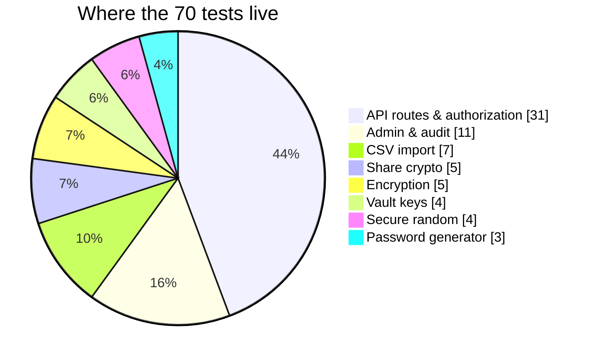

---

## 🧭 The big picture

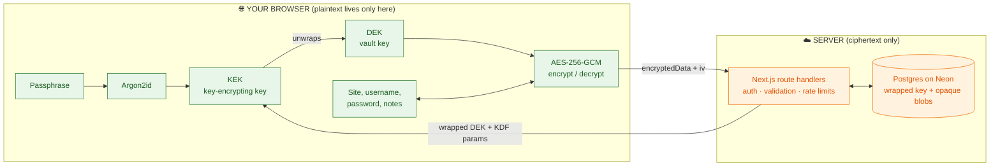

**The golden rule:** anything green exists *only* in your browser's memory. Anything orange never sees a readable secret.

---

## 🔑 Workflow 1: Creating your vault

You pick a passphrase once. From it, a chain of keys is built. Only the **wrapped** (encrypted) result is stored.

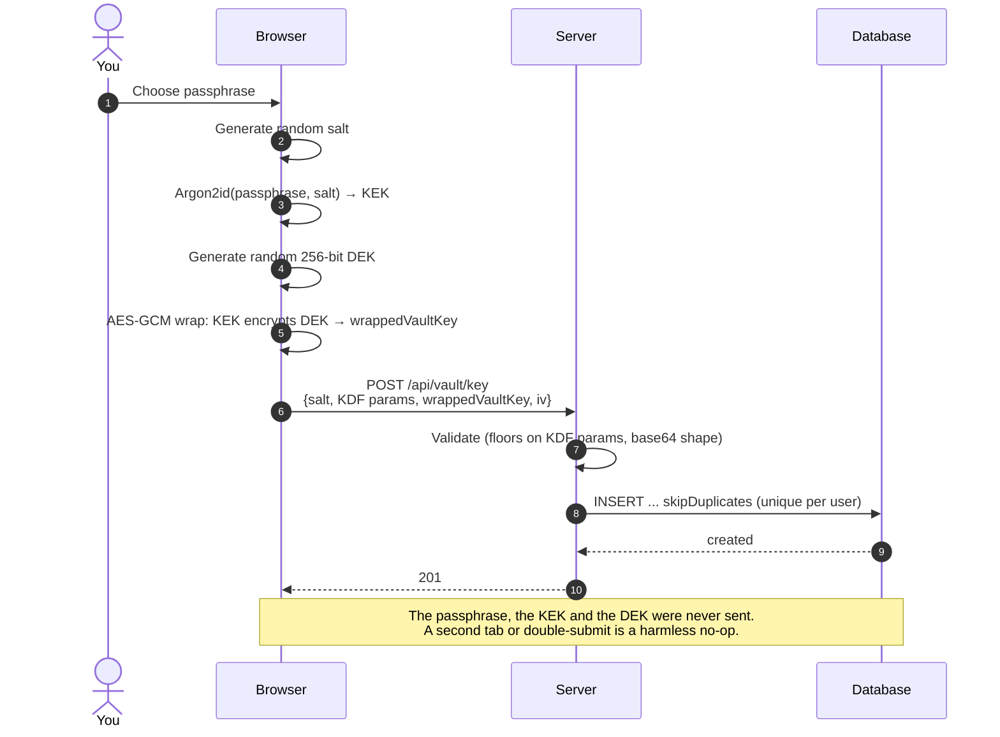

**Why two keys?** The DEK encrypts your data and never changes. The KEK is derived from your passphrase. That means **changing your passphrase only re-wraps one 32-byte key**, and no credential is touched. Passphrase changes use compare-and-swap, so a stale tab can't overwrite a newer key.

---

## 🗝️ Workflow 2: Saving and reading a credential

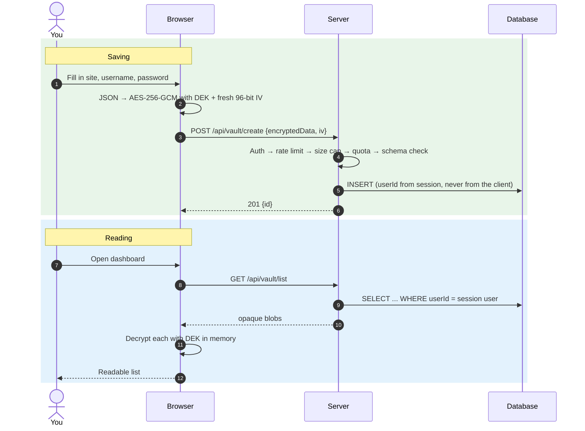

Every encryption uses a **fresh random IV**, and GCM's built-in tag means a flipped bit in the database is *detected*, not silently decrypted into garbage.

---

## 💌 Workflow 3: One-time sharing (the clever bit)

Sharing needs two things that travel by **different channels**:

| Piece | Where it lives | Role |
|---|---|---|
| 🔗 **Link** `/share/<token>#<linkKey>` | Sent via chat/email | `token` finds the share; `linkKey` (after the `#`) **never reaches any server** |
| 🔢 **6-digit OTP** | Read aloud / sent separately | A server-enforced gate: 5 tries, expiry, one-time use |

The OTP is *not* part of the encryption key. It's a bouncer, not a lock. The lock is the `linkKey`, which only the recipient's browser has.

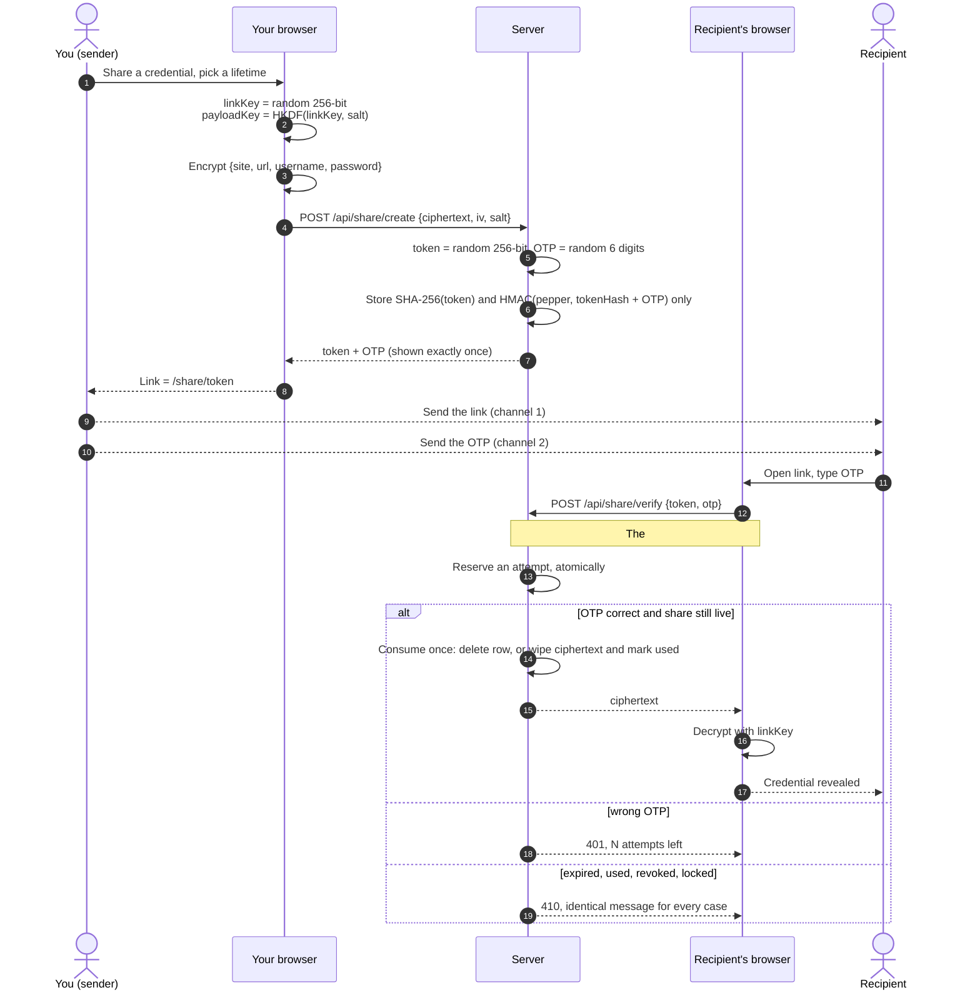

### What stops an attacker?

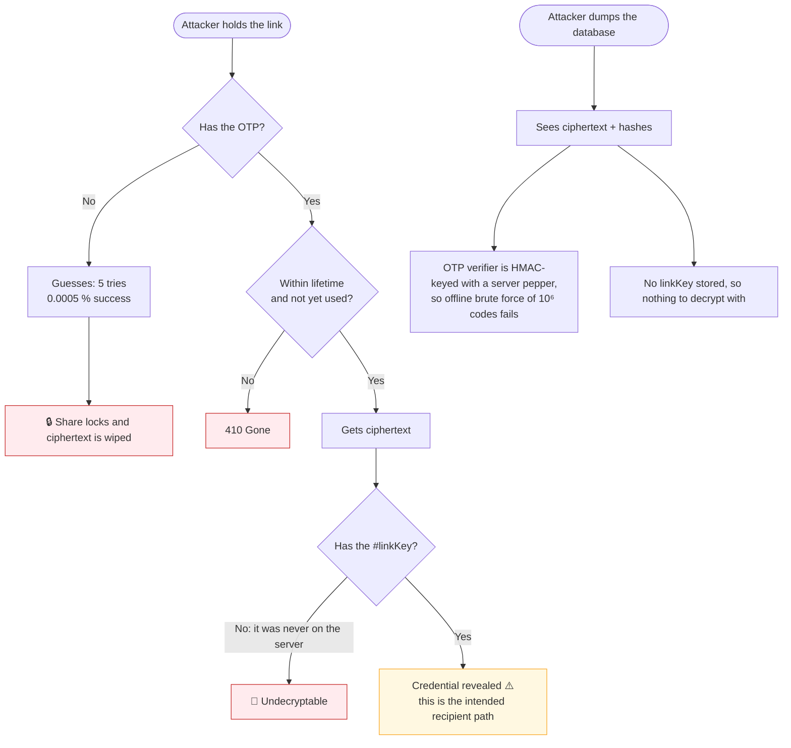

**Race-proof by design:** attempts are reserved with a *conditional* database update, and consuming a share is a single atomic write. Of any number of simultaneous correct requests, **exactly one wins**.

---

## 🛟 Workflow 4: "I forgot my passphrase"

A zero-knowledge system **cannot** recover a forgotten passphrase. If it could, it wouldn't be zero-knowledge. What it *can* do is let you start over, under human supervision.

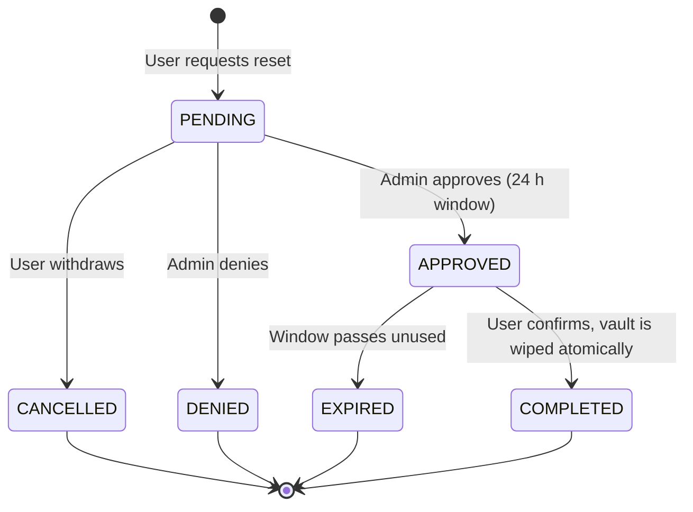

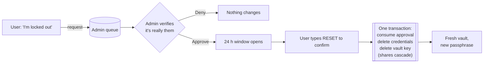

**Honest trade-off:** an approval authorises a **wipe**, never a read. Not even the admin can recover the old data. The approval is single-use, owner-bound and expiry-bound inside the same database `WHERE`, so a replay or a second tab finds nothing.

---

## 📥 Workflow 5: CSV import

Moving from Chrome, Firefox, Edge or Brave? Drop the export in.

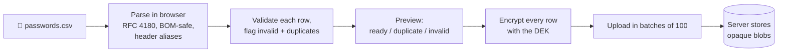

The plaintext CSV never leaves the page. Non-`http(s)` URLs (like Chrome's `android://…`) are moved into notes, so the **Open site** button can never follow a dangerous scheme.

---

## 🛡️ Defense in depth: every request runs this gauntlet

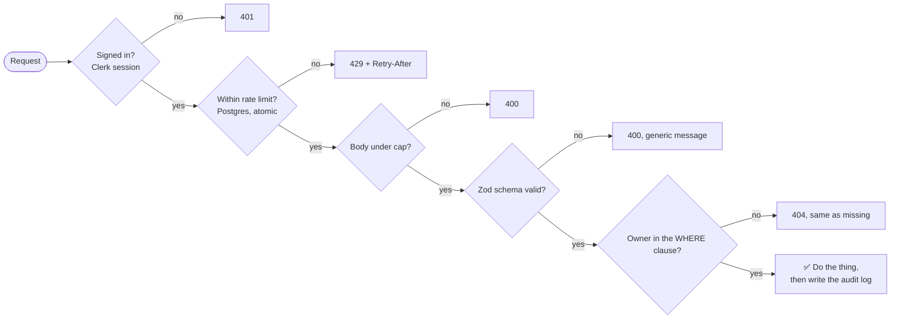

| Layer | Detail |
|---|---|
| **Identity** | Every route resolves the user from the **session**, never from a client-supplied id |
| **Ownership** | Checked *inside* the SQL `WHERE`, so a wrong id and someone else's id are indistinguishable (404) |
| **Rate limits** | Fixed-window, stored in Postgres (serverless instances share no memory). **Fails closed** on database errors |
| **Validation** | Zod on every body; base64 shape checks; KDF params must meet OWASP floors |
| **Body cap** | 32 KB by default, 2.5 MB for batch import |
| **Errors** | Generic messages, so nothing leaks *which* check failed |
| **Headers** | Nonce-based CSP, HSTS (2 years, preload), `no-referrer`, `X-Frame-Options: DENY`, `nosniff`, `no-store` on all API responses |
| **Audit** | Append-only trail of *what* happened to *which* record. Never secrets or ciphertext. 90-day retention |

### ⏱️ Rate limits at a glance

| Action | Limit | Window |
|---|---|---|
| Credential writes | 120 | per minute |
| Reads (list, get, key, shares) | 300 | per minute |
| Admin actions · audit events | 60 | per minute |
| Share verify (per IP) | 20 | 10 minutes |
| Share create | 30 | per hour |
| CSV import batches (≈ 6,000 rows) | 60 | per hour |
| Vault key writes | 10 | per hour |
| Reset request · reset execute | 5 each | per hour |

---

## 🗃️ Data model

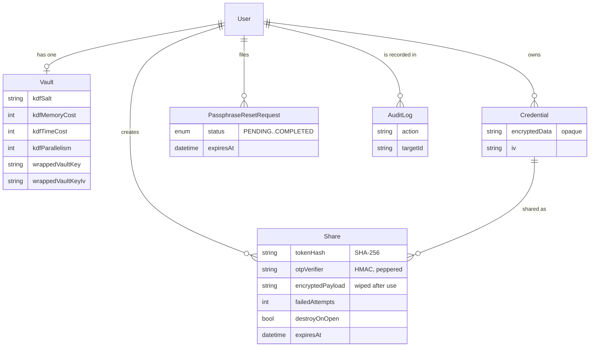

Plus a `RateLimit` table for the shared counters. **7 models, 1 enum.**

> 💡 The server literally has no column that could hold a site name or a username. They live inside `encryptedData`.

---

## 🧱 Tech stack

| Layer | Choice |
|---|---|
| Framework | **Next.js 16** (App Router, `proxy.ts`) · **React 19** |
| Auth | **Clerk v7** |
| Database | **PostgreSQL on Neon** via **Prisma 7** (`adapter-pg`) |
| Crypto | Native **Web Crypto** (AES-GCM, HKDF) + **hash-wasm** (Argon2id as WebAssembly) |
| Validation | **Zod 4** |
| Tests | **Vitest**, with an in-memory fake DB that mimics atomic SQL statements |

---

## 📁 Project map

```
app/
  api/            15 route handlers: vault, share, admin, audit
  (app)/          signed-in pages: dashboard, credential, shares, settings, admin
  share/[token]/  public recipient page
components/       vault · share · admin · landing · ui
lib/
  crypto/         encryption, key derivation, secure random, password generator
  share/          link crypto (client) + verifiers (server only)
  vault/          key setup/unlock, CSV parser
  validation/     Zod schemas
  auth/           current user, admin guard
  rate-limit.ts   read-json.ts   audit.ts
prisma/           schema + migrations
tests/            70 tests
```

---

## 🚀 Run it locally

```bash
npm install
cp .env.example .env.local     # Clerk keys, DATABASE_URL, SHARE_OTP_PEPPER, ADMIN_CLERK_USER_IDS
npx prisma migrate deploy
npm run dev
```

```bash
npm test          # 70 tests
npx tsc --noEmit  # types
npm run lint
```

| Env var | Purpose |
|---|---|
| `DATABASE_URL` | Postgres connection (Neon) |
| `SHARE_OTP_PEPPER` | Server-only secret keying OTP verifiers. Keep it out of the database |
| `ADMIN_CLERK_USER_IDS` | Comma-separated Clerk ids allowed into `/admin`. Empty means nobody |
| Clerk keys | Sign-in and sessions |

---

## ⚠️ Honest limits

Security docs that only list strengths aren't security docs.

- 🔤 **A weak passphrase is the weak link.** Argon2id slows guessing; it can't save `password1`.
- 🧩 **Metadata is visible.** The server can see *that* you have N credentials and *when* they change, not what they are.
- 🖥️ **A compromised browser or device wins.** Zero-knowledge protects against the server, not malware on your machine.
- 📋 **Client-reported audit events** (unlock, copy, reveal) are a convenience trail. Server-side events are the authoritative record.
- 🕳️ **No recovery by design.** Lose the passphrase and there's no reset that preserves data. Only a wipe.

---

<div align="center">

**Built so the most trustworthy thing about the server is that it can't be trusted with your secrets.**

</div>
